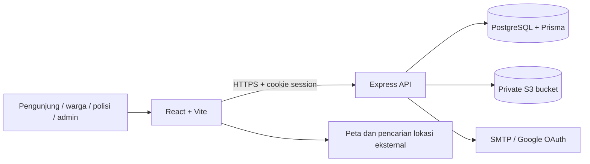

# Garda Jakarta | Aplikasi Web

Platform pelaporan keamanan warga Jakarta yang menghubungkan **laporan berbasis lokasi**, **penanganan unit polisi**, dan **pemantauan progres yang transparan**.

[Landing](https://gardajakarta.my.id) · [Peta publik](https://app.gardajakarta.my.id/map) · [Aplikasi](https://app.gardajakarta.my.id/login) · [Backend](https://github.com/GardaJakarta/GardaJakarta-BE)

## Tentang proyek

Informasi kejadian sering tersebar di berbagai kanal, sementara warga sulit mengetahui apakah laporan sudah diperiksa atau ditangani. Garda Jakarta menyatukan informasi lokasi, kronologi, bukti pendukung, dan riwayat status agar tindak lanjut lebih mudah dipantau.

Tujuan produk:
- Memudahkan warga menyampaikan laporan beserta lokasi dan bukti.
- Membantu polisi memprioritaskan antrian unit yang ditugaskan.
- Memperlihatkan progres melalui timeline, status, dan dokumentasi penanganan.
- Memberikan admin sarana pengelolaan data dan ringkasan operasional.

Data contoh digunakan untuk pengembangan dan evaluasi; visual area keamanan bukan statistik kriminal resmi atau jaminan keamanan suatu tempat.

## Peta repository

Ketiga repository dapat dibuka publik tanpa login (diperiksa 8 November 2026).

| Repository | Isi | Branch utama |
| --- | --- | --- |
| [GardaJakarta-FE](https://github.com/GardaJakarta/GardaJakarta-FE) | Aplikasi React: peta, feed, dashboard warga/polisi/admin | `main` |
| [GardaJakarta-BE](https://github.com/GardaJakarta/GardaJakarta-BE) | API, auth, database, upload, migration, Compose | `main` |
| [GardaJakarta-Landing](https://github.com/GardaJakarta/GardaJakarta-Landing) | Website pengenalan produk berbasis Next.js | `master` |

## Fitur berdasarkan peran

| Peran | Fitur yang tersedia |
| --- | --- |
| Pengunjung | Peta publik, pencarian lokasi, kategori/status/severity filter, kantor polisi, ringkasan area |
| Warga | Register/login, buat laporan dengan pin peta, upload/preview/hapus foto, laporan saya, feed, komentar bergambar, timeline, profile |
| Polisi | Antrian unit, pembeda laporan unit sendiri/lain, pembaruan status sesuai kewenangan, catatan dan bukti penanganan |
| Admin | Overview grafik, tabel per modul, detail/edit halaman penuh, CRUD unit/kategori/pengguna/laporan, gambar kategori, penugasan akun polisi |

Komentar warga dibuka melalui feed. Riwayat penanganan tetap tersedia dari detail di peta maupun feed. Form kategori, severity, dan status menggunakan komponen dropdown proyek. Panel dan navigasi menyesuaikan desktop/mobile, dengan skeleton saat data dimuat.

Routing awal memilih kantor aktif terdekat berdasarkan koordinat. Routing berdasarkan polygon yurisdiksi resmi belum diimplementasikan.

## Tech stack

| Kebutuhan | Teknologi |
| --- | --- |
| UI dan bahasa | React 19, TypeScript |
| Build dan routing | Vite 8, React Router 7 |
| Styling | Tailwind CSS 4, Plus Jakarta Sans, Urbanist |
| Peta/geometri | MapLibre GL, Turf |
| Ikon/animasi | Phosphor Icons, Motion |
| Autentikasi | Better Auth client, cookie HttpOnly |
| Hosting | Railway; Docker tersedia untuk lingkungan lokal |

Versi dependency yang terpasang dikunci pada [package-lock.json](package-lock.json).

## Arsitektur



## Rute dan struktur

| Rute | Fungsi |
| --- | --- |
| `/map` | Peta publik tanpa login |
| `/login`, `/register` | Autentikasi warga |
| `/polisi/login`, `/admin/login` | Portal masuk staff |
| `/dashboard` | Workspace sesuai role yang tersimpan di backend |
| `/dashboard/:resource/:recordId` | Detail admin: units, categories, users, reports |
| `/dashboard/:resource/:recordId/edit` | Edit admin; ID `new` membuka form tambah |
| `/profile` | Profile pengguna |
| `/` | Redirect ke landing production |

| Direktori/file | Tanggung jawab |
| --- | --- |
| `src/pages` | Halaman auth, peta, dashboard, profile |
| `src/components/admin` | Tabel, editor, grafik, halaman detail, location picker |
| `src/components/GardaMap.tsx` | Peta, marker, dan visual area |
| `src/context` | Bootstrap dan state session |
| `src/lib/api.ts`, `src/lib/admin-api.ts` | Client API dengan credentials |
| `src/styles.css` | Token dan layout antarmuka |
| `public/illustrations` | Ilustrasi kategori/status |
| `docker/Dockerfile` | Build dan runtime container frontend |

## Quick start dengan Docker

Prasyarat: Git dan Docker Engine/Docker Desktop dengan Linux containers serta Compose v2. Tidak perlu instal Node atau PostgreSQL di host.

```bash
git clone https://github.com/GardaJakarta/GardaJakarta-FE.git
git clone https://github.com/GardaJakarta/GardaJakarta-BE.git
cd GardaJakarta-BE
```

Ikuti [quick start Compose backend](https://github.com/GardaJakarta/GardaJakarta-BE#quick-start-dengan-docker) untuk menyiapkan `.env.docker`, kemudian:

```bash
docker compose --env-file .env.docker --profile app up --build -d --wait
docker compose --env-file .env.docker exec api npm run db:seed
```

Buka **http://localhost:4173/map**. Database lokal berada di volume Docker terpisah dari Railway. Akun staff hasil seed disimpan di volume credential lokal; lihat README backend untuk membacanya dan login tiap role.

Build frontend secara terpisah:

```bash
docker build -f docker/Dockerfile --build-arg VITE_API_URL=http://localhost:4000/api -t garda-jakarta-fe .
docker run --rm -p 127.0.0.1:4173:4173 garda-jakarta-fe
```

Jalankan perintah build tersebut dari folder frontend. Backend tetap harus aktif dan mengizinkan origin `http://localhost:4173`. `VITE_API_URL` ditanam saat build; mengubah environment container setelah build tidak mengganti URL di browser.

## Menjalankan tanpa Docker

Prasyarat: Node.js **22.12+**, npm, dan backend lokal di port 4000. Gunakan [panduan backend](https://github.com/GardaJakarta/GardaJakarta-BE#menjalankan-tanpa-docker) terlebih dahulu.

```bash
git clone https://github.com/GardaJakarta/GardaJakarta-FE.git
cd GardaJakarta-FE
npm ci
```

Salin `.env.example` menjadi `.env`:
- PowerShell: `Copy-Item .env.example .env`
- macOS/Linux: `cp .env.example .env`

```dotenv
VITE_API_URL=http://localhost:4000/api
```

```bash
npm run dev
```

Buka **http://localhost:5173/map** atau **http://localhost:5173/login**. Tanpa `VITE_API_URL`, dev server Vite meneruskan `/api` ke port 4000. Server build statis tidak menyediakan proxy itu, sehingga gunakan URL API absolut saat build.

## Verifikasi dan alur evaluasi

```bash
npm run typecheck
npm run lint
npm run build
npm start
```

`npm start` menyajikan hasil build di **http://localhost:4173**. Pastikan CORS backend menyertakan origin tersebut.

1. Buka `/map`, cari lokasi, pilih pin, dan coba filter.
2. Register warga, lalu buat laporan menggunakan lokasi peta dan kronologi.
3. Periksa laporan saya dan timeline. Upload foto memerlukan S3 yang dikonfigurasi.
4. Login polisi hasil seed melalui `/polisi/login`, lalu periksa antrian dan detail.
5. Login admin melalui `/admin/login`, buka grafik serta tabel unit/kategori/pengguna/laporan.
6. Ulangi navigasi di layar mobile; detail admin tetap berupa halaman, bukan modal.

## Progress dan batasan

Status dokumentasi: **8 November 2026**, berdasarkan implementasi pada branch utama. "Tersedia" berarti fitur ada di kode; bukan klaim seluruh skenario produksi sudah bebas bug.

| Area | Status | Bukti implementasi |
| --- | --- | --- |
| Auth, profile, navigasi per role | Tersedia | `src/App.tsx`, `src/context`, `src/pages/ProfilePage.tsx` |
| Peta, pin, filter, area keamanan | Tersedia | `src/components/GardaMap.tsx`, `src/components/MapFilters.tsx` |
| Laporan, feed, komentar, timeline | Tersedia | `src/pages/DashboardPage.tsx`, `src/components/ReportConversation.tsx` |
| Admin: grafik, tabel, CRUD halaman | Tersedia | `src/components/admin` |
| Katalog gambar kategori | Tersedia; perlu storage | `src/components/CategoryImage.tsx` |
| Verifikasi OTP | Implementasi tersedia; perlu SMTP | `src/components/EmailVerification.tsx`, [setup OTP backend](https://github.com/GardaJakarta/GardaJakarta-BE/blob/main/docs/email-otp.md) |
| Routing polygon resmi | Belum tersedia | Saat ini kantor aktif terdekat |
| Analitik keamanan terverifikasi | Rencana | Visual area saat ini bersifat indikatif |

Dependensi eksternal: tile peta dan pencarian lokasi perlu internet, Google login perlu OAuth, serta foto perlu bucket. SMTP belum termasuk Compose. Status aktivasi layanan production mengikuti konfigurasi operator.

## Deployment dan keamanan

Railway memakai branch `main`, build `npm run build`, start `npm start`, dan `VITE_API_URL=https://api.gardajakarta.my.id/api`. Dockerfile disimpan dalam `docker/` agar tidak otomatis mengganti builder Railway yang sudah ada.

- Role ditentukan backend; register publik menghasilkan `WARGA`.
- Session memakai HttpOnly cookie; token auth tidak disimpan di `localStorage`.
- Data identitas pelapor tidak dicantumkan pada peta publik.
- Variable `VITE_*` terlihat di browser. Jangan isi dengan secret SMTP, database, OAuth, atau bucket.

## Troubleshooting

| Gejala | Pemeriksaan |
| --- | --- |
| Peta terbuka, laporan kosong | Pastikan API sehat, jalankan seed lokal, lalu periksa filter |
| Login gagal/CORS | Pakai hostname yang sama (`localhost`), periksa `BETTER_AUTH_URL` dan `CORS_ORIGIN` backend |
| Foto gagal diunggah | Isi konfigurasi S3 backend dan periksa batas format/ukuran |
| URL API salah setelah deploy | Ubah build arg/environment Vite lalu build ulang |
| Port terpakai | Hentikan service lokal yang bentrok atau ubah `API_PORT`/`WEB_PORT` Compose |

## Kontribusi

Buat branch dari `main`, jelaskan perubahan dan langkah reproduksi, jalankan quality checks, lalu ajukan pull request. Sertakan screenshot desktop/mobile untuk perubahan UI. Gunakan [Issues](https://github.com/GardaJakarta/GardaJakarta-FE/issues) untuk bug tanpa menyertakan credential atau data pribadi.
